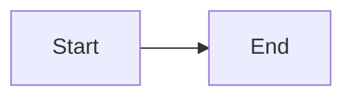

<p align="center">
  
</p>

# Engineering Blog

Source repository for engineering blog posts published on [openteams.com/engineering-blog](https://openteams.com/engineering-blog/).

## How It Works

1. Write your post as a `.md` file in `posts/`.
2. Open a pull request for review.
3. Once merged to `main`, the post goes live.

Changing the site's code or settings? See [DEVELOPMENT.md](DEVELOPMENT.md).

## Guest Posts

Only people with write access can open pull requests here. If you're a guest author, or an OpenTeams member with read-only access:

1. Open a [Request write access](https://github.com/openteams-ai/engineering-blog/issues/new?template=request-write-access.yml) issue. OpenTeams members get write access within a minute, and the issue closes itself.
2. Guests only: if the admin approves, accept the email invite from GitHub.
3. Follow the [Writing Guide](#writing-guide).

## Repository Structure

```text
posts/
├── building-ml-pipelines.md        # Article files
├── scaling-with-duckdb.md
└── images/
    ├── building-ml-pipelines/      # Images per article
    │   └── architecture.png
    └── scaling-with-duckdb/
        └── benchmark.png
authors.json                        # Author names, bios and photos
```

## Writing Guide

### Creating a Post

1. Create `posts/your-article.md`: [frontmatter](#frontmatter) at the top, then your content in markdown.
2. First post? Add yourself to `authors.json` (see [Author Profile](#author-profile)).
3. Write a title, slug and meta description.\
   With Claude Code: `/seo-meta-description posts/your-article.md`
4. Draw a thumbnail in `src/components/art/<slug>.astro`, using an existing one as a model.\
   With Claude Code: `/draw-featured-image posts/your-article.md`
5. Open a PR from a branch in this repo rather than a fork.

The PR's checks fail until your post has a thumbnail and authors listed in `authors.json`.

### Preview

- **On your PR:** CI comments a preview link to the whole site with your post in it, and updates it on every push.
- **Locally:** run `npm install` once, then `npm run dev` and open <http://localhost:4321/engineering-blog>. The page reloads on every save.

### Frontmatter

```yaml
---
title: "Your Post Title"
slug: your-post-slug
date: 2026-10-01
topic: ai-engineering
authors:
  - your-author-slug
meta_description: "A short summary for search and link previews (150-160 chars)."
---
```

| Field | Required | Notes |
| --- | --- | --- |
| `title` | ✅ | |
| `slug` | ✅ | The post's address. Don't change it once the post is live. |
| `date` | ✅ | |
| `topic` | ✅ | One of `llms-inference`, `ai-engineering`, `python-tooling`, `code-quality` |
| `authors` | ✅ | Slugs from [`authors.json`](#author-profile). The first is the main author. |
| `meta_description` | Recommended | 150–160 characters for search and link previews |

With Claude Code, `/seo-meta-description posts/your-article.md` suggests the title, slug and meta description.

### Author Profile

If this is your first post, add yourself to `authors.json`:

```json
{
  "slug": "your-author-slug",
  "name": "Your Name",
  "bio": "Your role at OpenTeams and what you write about.",
  "avatarUrl": "https://avatars.githubusercontent.com/u/<your-id>",
  "links": { "github": "https://github.com/<you>", "linkedin": "https://www.linkedin.com/in/<you>/" }
}
```

The easiest `avatarUrl` is your GitHub avatar's address. To use a photo file instead, put it in `public/authors/<slug>.jpg` (about 264px wide) and set `avatarUrl` to `/authors/<slug>.jpg`.

`links` is optional: `github`, `linkedin`, `x`, `bluesky` or `website`, each a full address. They show as icons on your author page and under your posts.

### Images

Place images in `posts/images/<post-slug>/` and reference them with relative paths.

```markdown

```

### Card Art

Your post's thumbnail is a small drawing that shows its main idea.

- **Draw it:** with Claude Code, run `/draw-featured-image posts/your-article.md`, or manually edit `src/components/art/<slug>.astro`.
- **See it:** run `npm run dev` and open <http://localhost:4321/engineering-blog/card-preview/your-post-slug/>. The page reloads when you save.

### Markdown Syntax Reference

#### Code Blocks

Code blocks are syntax-highlighted. Name the language after the opening fence:

````markdown
```python
def hello():
    print("Hello, world!")
```
````

#### Mermaid Diagrams

Rendered automatically. Readers can click a diagram to open it full screen.

````markdown

````

#### Other Supported Elements

| Element | Syntax |
| --- | --- |
| Bold | `**text**` |
| Italic | `*text*` |
| Inline code | `` `code` `` |
| Link | `[text](url)` |
| Image | `` |
| Blockquote | `> text` |
| Table | Standard markdown table syntax |
| Horizontal rule | `---` |
| Ordered list | `1. item` |
| Unordered list | `- item` |
| Nested list | Indent with 2 or 4 spaces |
