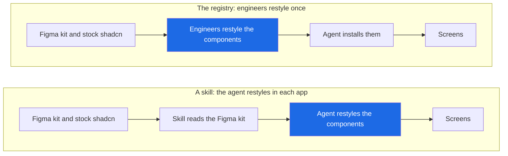

Here's the question I wanted to answer. If an AI agent can follow a skill that turns a design into components on demand, do we still need to maintain a design system in code?

A design system in code is real work. Someone builds each component, documents it, releases it, and keeps it in step with what the designers draw. A skill sounds lighter: start from stock components, write down how to restyle them from the design, and let the agent build what each screen needs.

This isn't only a design system question. Skills are useful, but a skill that generates the same thing on every run pays for it every run. Once the work repeats, turning the output into reusable code makes it cheaper, faster and consistent. A design system is one case of that. I tested it on UI because that's where I work, and a Figma kit gives a clear source to measure against.

I tested that on [Nebari design](https://github.com/nebari-dev/nebari-design), our design system for Nebari. This post is what happened.

The problem: we want Nebari UIs that match the Figma design, without someone updating components by hand every time the design changes.

## The two approaches

The difference is who makes the components match the design, and when. With the registry, engineers do it once. With a skill, the agent does it on every build.

Both approaches start from the same place: [shadcn](https://ui.shadcn.com/) components built on [Base UI](https://base-ui.com/), which supplies the keyboard and ARIA behavior.

**The registry.** Nebari design ships as a component library, distributed as a [shadcn registry](https://nebari-dev.github.io/nebari-design/). Engineers restyled shadcn to match the Nebari design once, added what Nebari needs, and released it. You run a command, and a finished component lands in your repo. A skill tells the agent which component to use where.

**A skill.** There's no Nebari component code to install. A skill called [`kit-ui`](https://github.com/jbouder/skills/tree/main/kit-ui) does the design system's job in each app. It installs each stock shadcn component the screen needs, then reads the Nebari Figma kit through the Figma MCP server and restyles the component from it. shadcn keeps its parts, props and behavior. The Figma kit decides every color, border, radius, size, spacing, text style and shadow. The skill also records which Figma node each component came from.

One caveat up front: both approaches depend on a well-made Figma UI kit. The registry's engineers restyled from it, and the skill reads it on every build. Our designers built the Nebari kit with care. Nearly every color in its components points at a named color, like "background" or "border," which an agent can carry into code as a token, and every component state is drawn. A skill can stand in for component code, not for the design work behind it. If the kit is thin, out of date or inconsistent, both approaches get worse. The skill gets worse faster, since no engineer sits between the file and the code.

## A fair test

Comparing AI builds is easy to get wrong. One build will look better, and you'll want to believe it. So I wrote the rules down before running anything.

- **Same screens.** Four frames from a chat UI design: an answer screen in light and dark, the same screen at 1024 pixels wide, and a history table.
- **Same prompt.** The two prompts differ only in the section that says which design system to use.
- **Same model, fresh sessions.** I built each approach three times, each in a new session that couldn't see the others. Every number below is an average.
- **A judge that's a script.** It screenshots each build and compares it with the Figma frame, runs axe, tabs through every control, tests keyboard behavior by ARIA role, checks for sideways scrolling at four widths, and runs a production build.

The judge flags a **defect** when something is wrong whatever the build looks like: an accessibility violation, a control with no visible focus, a keyboard check that fails, a page that scrolls sideways, a build that fails.

That left fidelity: how close each build is to the design.

## Pixels are the wrong measure of fidelity

My first judge compared each screenshot with the Figma frame and reported the percent of pixels that differed. It's a number a script can produce, and it looks objective. On this test it says the skill is closer: 8.0% against 9.5% for the registry.

Look at the screenshots, and the number doesn't match what you see.

- **It punishes things nobody can see.** The registry scores 13% on the history table because the table sits one pixel lower than the design. A one-pixel shift moves the edge of every letter, so thousands of pixels "differ." Side by side, the two look identical.
- **It barely registers things anyone can see.** The skill's builds draw the sort arrows in the table header near-black, where the design has them gray. You see it as soon as the two sit side by side. The arrows are a small patch of the screen, so the number hardly moves.

I learned that on an earlier test, and switched before this one. Fidelity is now a count of **visible differences**: what a person would see as wrong when the build sits next to the design. A reviewer goes through every screen, cut into tiles at full size, and lists each difference with a severity. *Obvious* means seen at a glance. *Noticeable* means seen when comparing side by side. *Subtle* means real, but likely missed. A wrong element counts once, however many screens it appears on.

The reviewer was a separate Claude session that saw the builds only as letters. I checked its noticeable findings against the screenshots and changed none of its ratings.

The pixel number is still in the report, labeled as a smoke test. It catches a page that's broken or empty, and nothing finer.

## What happened

| Average per build | Registry | Skill |
| --- | --- | --- |
| Obvious differences | 0 | 0 |
| Noticeable differences | 1.7 | 1.3 |
| Subtle differences | 5.0 | 3.0 |
| Defects | 0 | 0 |
| Keyboard checks failed | 0 | 0 |
| Design-system code in the repo | 2,332 lines | 1,926 lines |
| JavaScript shipped (gzip) | 152 kB | 152 kB |
| Build time | 6m 30s | 19m 25s |
| Tokens | 186,410 | 379,610 |
| Calls to Figma | 4 | 12.7 |

**Fidelity came out even.** Neither approach produced anything a person would see at a glance. Each averaged between one and two differences you'd notice with the build next to the design. The skill's numbers are a little lower, and the gap is too small to call.

Each approach has small habits of its own. The registry leaves the active sidebar item at regular weight where the design makes it heavier, and rounds its corners a little more than the design. The skill draws the sort arrows near-black where the design has them gray, and squares off the tops of the chart bars.

*Cropped from the screenshots. A red border marks a build that differs from the design.*

Four more differences showed up in every build. The clearest is at 1024 pixels wide, where the answer text shows up below the chart and the composer cuts it off. The design leaves blank space there. When both approaches make the same call every time, the frame is probably unclear in that spot, so those don't separate the two.

**Accessibility tied.** No build had an accessibility violation. Every control was reachable by keyboard with a visible focus state, and nothing scrolled sideways.

## The skill costs twice the tokens

This is where the two approaches separate.

| Average per build | Registry | Skill |
| --- | --- | --- |
| Tokens | 186,410 | 379,610 |
| Build time | 6m 30s | 19m 25s |
| Calls to Figma | 4 | 12.7 |

A skill build used about 193,000 more tokens to make the same four screens: twice the registry. It also took three times as long.

The reason is where the work happens. With the registry, engineers did the restyle once, and a build installs the result. With the skill, the agent reads the Figma kit and restyles each component in every app that needs it. The registry pays its cost once, in engineering time. The skill pays in tokens, every time.

## What the design system adds

Both approaches get the same behavior from shadcn. Its sidebar is 718 lines, with collapse to a rail, a mobile sheet and a keyboard shortcut, and neither build had to write that logic. The difference is what the design system adds on top.

Nebari's engineers made decisions a Figma file can't show. The registry's checkbox is 203 lines, with a group, a label and a description. The skill's checkbox is under 30: shadcn's box, restyled. The registry's `Button` has a loading state that sets `aria-busy`. Stock shadcn's doesn't.

Those decisions were made once, and every app gets them. With a skill, each app makes them on its own, if it makes them at all, and two apps may make them differently. That consistency is what a design system is for, and it's the part a skill can't replace.

## Where I land

For Nebari, the registry stays. Fidelity doesn't separate the two, so it comes down to cost and extras. A registry build takes a third of the time and half the tokens, and it carries what Nebari's engineers added that shadcn and the Figma kit don't have. Every app gets the same thing. I'd run the skill next to it as a checker, since it reads the same file and reports where code and design have drifted.

For a new line of UIs, I'd start with stock shadcn and the skill. It matched a mature registry on fidelity and accessibility, with no component library to build first. Early on, components change every week, and you don't yet know which ones you need. A change in Figma is a restyle, not a release. Four things make it work:

1. **Make the Figma kit for the skill.** Give each variable a CSS name, and note which primitive each component builds on, like a select for a `Select`. Both are cheap to add when the file is new.
2. **Give one person the rules.** When two builds disagree, someone has to tighten the skill.
3. **Commit what it generates.** The next build should reuse a component, not restyle it again. That's also how you keep the token bill down.
4. **Review the result by eye.** Every build had something a person would notice, and no automated check caught it. Someone has to look, whichever approach you use.

Move to a registry when a second app needs the same components, when the token bill for restyling passes the cost of an engineer doing it once, or when you catch yourself adding the same loading state to a button for the third time. The restyled components are a good starting point, since they already match the design.

## What this doesn't show

- **A well-made Figma kit.** Both approaches lean on the Nebari kit, and it's a careful file. With a weaker kit, I'd expect both to score worse, and the skill to fall further.
- **A small sample.** The fidelity averages are close, and more builds could flip them. The cost gap is large, and I'd expect it to hold.
- **One reviewer.** Severity is a judgment call. A designer might rank things differently. The header logo was out of scope.
- **Four screens, mostly static.** No dialog, no form, no complex menu. That's where engineered behavior matters most, and where the registry's extras would count.
- **A young skill.** Its restyle rules have run on one Figma kit.

## The short version

Can a skill replace a design system? On fidelity and accessibility, yes: on the same shadcn base, a skill that reads the Figma kit matched our component library. On cost and consistency, not yet. The skill took three times as long and twice the tokens, and it doesn't carry what Nebari's engineers added. Either way, the design still has to exist: both approaches are only as good as the Figma kit behind them. Use the registry where you have one. Start with stock shadcn and a skill where you don't, and review what it builds. And be careful what you measure: the pixel number said the skill was closer, and a reviewer called it even.
