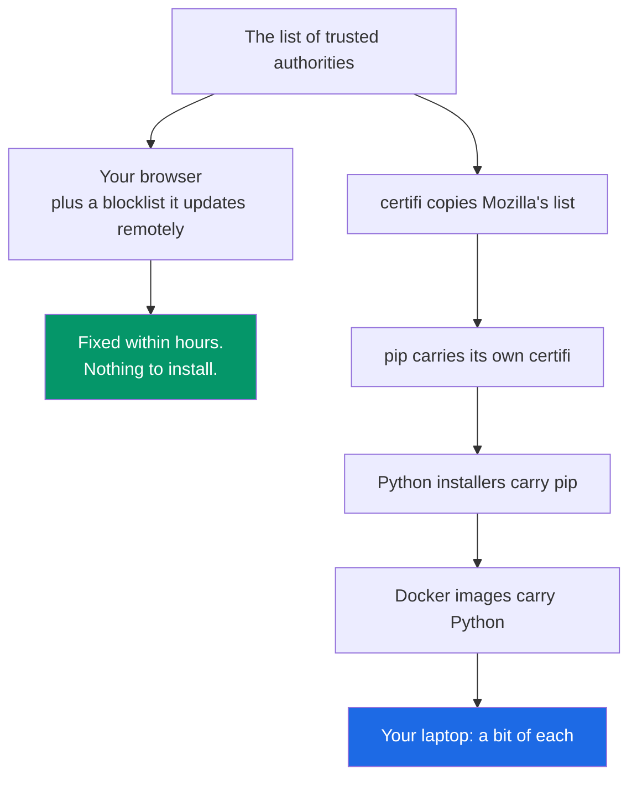

Type `pip install` and press enter. Before a single byte downloads, your computer asks the server on the other end a question: who are you?

The server answers with a certificate, a kind of ID card, signed by a company that vouches for it. Your computer checks that signature against a list. The list names every organization your computer has agreed to believe. You have never seen it. You did not choose anyone on it. It sits underneath every padlock in your browser and every package you have ever installed.

Since April 2025, one of the keys your computer trusted was the number 4.

## A stamp anyone could carve

Think of a certificate authority as a notary, and its private key as the notary's stamp. Anything stamped with it, your computer believes. The whole system rests on one assumption: nobody else can make the stamp.

eMudhra is a certificate authority based in India, trusted by every major browser and operating system. In April 2025 it created eight new intermediate certificates, six of them for websites. By eMudhra's own account, a flaw in how the keys were generated left them weak. On Saturday, 17 October 2026, someone reported to Google and Mozilla that the keys could be worked out from public information. A few days later, security researcher Scott Helme [recovered all eight](https://www.theregister.com/security/2026/10/20/indian-certification-authority-emudhras-private-keys-compromised-one-of-them-was-the-number-4/5304312) on a laptop in under a second. One was 4. Others were 56 and 115.

A proper key is a random 384-bit number. That gives about 10115 possible values, more than there are atoms in the observable universe. eMudhra's keys were small enough to find by counting.

With that stamp, anyone who could get between you and the internet, on café wifi or through a compromised router, could pretend to be pypi.org and hand you a different package. Your computer would check the ID, find a valid stamp, and install it. Only installs pinned to exact file hashes would have caught the swap, and most installs aren't pinned that way. The exposure went beyond installs, too. Popular HTTP libraries like requests check the same list through certifi, so any password or API key a Python program sent over the web was open to the same trick.

Did anyone use the keys? Nobody knows. Chrome requires website certificates to be recorded in public logs, and Google found none issued under these keys, so an attack on Chrome users would probably have left a trace. Python tools don't check those logs. Someone going after `pip install` would have had no reason to record anything.

## The list, and its copies

Chrome and Firefox fixed this in an evening. Chrome blocked the six website certificates in under two hours. [Firefox users were protected](https://blog.mozilla.org/security/2026/10/20/protecting-firefox-users-following-the-compromise-of-emudhra-intermediate-certificates/) by 22:59 UTC that same night. Most people didn't have to install anything. Browsers keep a separate blocklist on top of their built-in list, and they can update it remotely, at any hour.

Python tools have no remote blocklist, and they don't share a single list. Each one carries its own copy.

Mozilla maintains one of the most widely used versions of the list. A Python package called [certifi](https://pypi.org/project/certifi/) copies it. pip, the tool that installs Python packages, carries its own copy of certifi tucked inside it. Python's installers carry a copy of pip. Docker images carry a copy of Python. Build servers cache the Docker images. Newer tools like uv and pixi compile their own copy straight into the program. And your laptop holds a little of each, frozen at whatever moment you last set it up.

Updating your operating system doesn't reach most of these copies. As CPython core developer Christian Heimes explained in the [Python security thread](https://discuss.python.org/t/information-for-python-users-regarding-emudhra-emsign-ca-certificate-security-incident/109576), pip "always loads the CA certificates from its vendored certifi in addition to the system trust store." His advice: "Updating pip is the only reliable fix."

Fixing the problem meant finding every copy and replacing it.

## Finding the copies

Seth Larson of the Python Software Foundation posted the [advisory](https://discuss.python.org/t/information-for-python-users-regarding-emudhra-emsign-ca-certificate-security-incident/109576) on Tuesday, 20 October. By then the easy copies were already fixed. certifi, pip and uv had new releases out, and conda-forge's build bot picked them up within hours.

The harder copies were the ones baked into something else. Python's installers carry their own pip. So do Docker images, build servers, and the tool Python uses to set up every new environment, a copy that makes copies. Updating pip on your laptop doesn't touch any of them. Each has to be rebuilt by whoever makes it.

So the forum thread turned into a running list of places an old copy might be hiding. What about the official Docker images? What about Debian's version of pip? Someone would ask, someone else would check, and the answer was either "that one's fine" or a new fix. By Wednesday the Python core team had shipped [new releases of Python itself](https://blog.python.org/2026/10/python-3151-3149-31317/), including one for a version that doesn't normally get this kind of update.

The hardest copies were the ones already installed. conda-forge can't reach into anyone's machine, but it does control the index that conda and mamba read to decide which packages go together. Its maintainers edited that index so that installing an older version of mamba or conda's solver now brings the fixed list along with it. My colleagues at OpenTeams were among the people doing this work on the conda-forge side.

By Thursday, five days after the first report, the main Python install tools all had fixed releases.

## The copies nobody has found yet

Some copies are harder to find. A few packages carry their own copy of the list as a plain file, usually named `cacert.pem`, with no version number attached. As [Endor Labs points out](https://www.endorlabs.com/learn/emudhra-intermediate-ca-compromise-the-trust-stores-you-patched-and-the-ones-you-didnt-know-you-had), a file like that doesn't show up in a software bill of materials, so nothing flags it when it goes out of date. Our team has started checking every package on conda-forge for one.

Longer-term fixes are under discussion too. In the same security thread, Christian Heimes proposed letting Python's own `ssl` module block known-bad certificates directly, the way Go's standard library already does. pip's maintainers have an open issue about relying on the operating system's list instead of carrying their own.

The next time you type `pip install`, your computer will ask who is on the other end and check the answer against a list. The list is new now. Dozens of people reprinted it, in public, over a few days in October, and then went looking for every other copy.

## If you run Python: check these now

Chrome and Firefox fixed themselves. Your Python tools are fixed only when you update them. The [Python security advisory](https://discuss.python.org/t/information-for-python-users-regarding-emudhra-emsign-ca-certificate-security-incident/109576) has the full list; these are the steps that matter for most people.

1. Upgrade pip to 26.2.2 or newer in every environment. It carries its own copy of the list, so this is the step that counts. It needs Python 3.10 or newer.
2. Upgrade certifi to 2026.10.19 or newer, including in lockfiles and pinned requirements.
3. If you use them, update uv (0.13.4 or newer), pixi (0.82.1 or newer) and conda (26.9.4 or newer, plus `ca-certificates` in every environment).
4. Install your operating system's updates too. Some Python tools read its certificate list instead of their own.
5. Rebuild container images and CI caches from scratch, so they pick up the new versions.
6. Don't turn off certificate checking to make an error go away.

## Acknowledgments

Thanks to everyone who worked through the response in public, including Seth Larson, Christian Heimes, Paul Moore, Zachary Ware, William Woodruff, Hugo van Kemenade, Sumana Harihareswara, Eric Swanson, Henry Schreiner and Jannis Leidel, and to my OpenTeams colleagues Isuru Fernando, Sophia Castellarin, Michał Górny, Jaime Rodríguez-Guerra, Axel Obermeier and Vinicius Cerutti.

## References

- **[Information for Python users regarding eMudhra / emSign CA certificate security incident](https://discuss.python.org/t/information-for-python-users-regarding-emudhra-emsign-ca-certificate-security-incident/109576)** (Python Software Foundation, 2026): The advisory, the fixed versions, and the follow-up thread quoted here.
- **[Python 3.15.1, 3.14.9 and 3.13.17 are out](https://blog.python.org/2026/10/python-3151-3149-31317/)** (Python Insider, 2026): The CPython releases that ship the fixed pip and certifi, including the exception for 3.13.
- **[Security updates for conda, Mamba, and Pixi](https://conda.org/blog/2026-10-21-emudhra-security-updates/)** (Jannis Leidel, 2026): Fixed versions for the conda ecosystem and the index fixes for older builds.
- **[eMudhra CA response](https://github.com/conda-forge/conda-forge.github.io/issues/2967)** (conda-forge, 2026): The images, installers and services conda-forge rebuilt.
- **[Protecting Firefox users following the compromise of eMudhra intermediate certificates](https://blog.mozilla.org/security/2026/10/20/protecting-firefox-users-following-the-compromise-of-emudhra-intermediate-certificates/)** (Mozilla, 2026): When and how Firefox blocked the certificates.
- **[Indian certification authority eMudhra's private keys compromised](https://www.theregister.com/security/2026/10/20/indian-certification-authority-emudhras-private-keys-compromised-one-of-them-was-the-number-4/5304312)** (The Register, 2026): Scott Helme's recovery of the keys, including the key equal to 4.
- **[Eight eMudhra CA keys compromised](https://thehackernews.com/2026/10/eight-emudhra-ca-keys-compromised.html)** (The Hacker News, 2026): The timeline of the report and each vendor's response, including Chrome's certificate log check.
- **[eMudhra CA compromise: the trust stores you didn't patch](https://www.endorlabs.com/learn/emudhra-intermediate-ca-compromise-the-trust-stores-you-patched-and-the-ones-you-didnt-know-you-had)** (Endor Labs, 2026): Hidden trust stores and bundled `cacert.pem` files.
- **[eMudhra / emSign CA compromise: what Python, pip, and CI/CD users need to update](https://www.stepsecurity.io/blog/emudhra-emsign-ca-compromise-python-pip-ci-cd-update)** (StepSecurity, 2026): CI/CD guidance and pip's Python 3.10 requirement.
