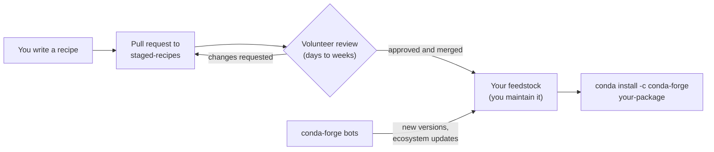
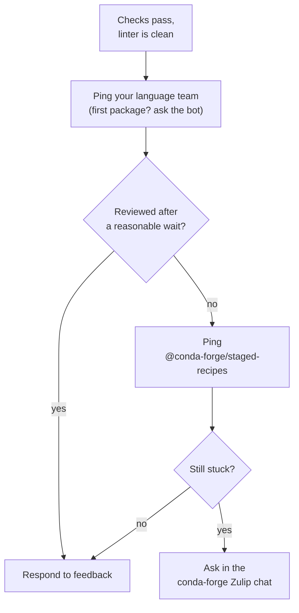

If you run `conda list` in a conda environment, you'll see a long list of packages. The last column displayed says where each one came from. In many environments, most of them say `conda-forge`. 

And each of those packages got onto conda-forge the same way.

Someone wrote a recipe for building the package, and someone else read that recipe line by line before it was accepted. Most of the people doing that reading are volunteers.

Your company's Python stack runs on their work, and at some point, you'll probably want to add a package of your own to that list.

At OpenTeams, we help clients publish their software on conda-forge, and some of our engineers review and maintain recipes there. This post is what we've learned about doing that well in a community run largely by volunteers.

## How a package gets in

conda-forge is a community-run collection of more than [34,000 packages](https://conda-forge.org/packages/), built for Linux, macOS and Windows. What makes it trustworthy is that every new package goes through the same review and is built under the same rules. That trust is also why it's one of the most dependable ways to get your own software to scientific Python and data users.

You don't have to maintain a project to package it. Anyone can submit a recipe, so if your team depends on a library that isn't on conda-forge yet, you can add it yourself. If you do, it's good form to let the upstream maintainers know and invite them to help maintain the conda-forge package.

Getting a new package into conda-forge takes three steps:

1. You write a recipe, a short `recipe.yaml` file that says where the source code lives, how to build it, what it depends on and how to test it. For a Python package already on PyPI, a tool called `grayskull` can draft one in the current format, but a person still needs to check it, especially the license and the dependencies.
2. You open a pull request against the [staged-recipes](https://github.com/conda-forge/staged-recipes) repository, where a volunteer reviews it.
3. Once it's merged, conda-forge creates a feedstock, a repository of its own for your package. From then on, you're one of its maintainers.

The review is the step that requires patience because a package that's new to conda-forge gets a careful look. conda-forge publishes [the checklist reviewers work from](https://conda-forge.org/docs/maintainer/guidelines). Among other things, they confirm the license is identified correctly and allows redistribution, the source doesn't bundle other projects' code or ship precompiled files, the package has tests, and its dependencies aren't pinned more tightly than they need to be. 

That first review sets the baseline everyone else relies on, then keeping the package trustworthy is up to its maintainers.

## Build the review into your schedule

Review times ["may be days or weeks,"](https://github.com/conda-forge/staged-recipes) depending on how many reviewers a language team has. So treat the review as part of the release plan. If a release depends on a conda-forge package, open the pull request weeks ahead, not days.

The best thing you can do to speed up the review is respect reviewers' time. That holds even for people who could skip it. Some of those OpenTeams engineers, and some of our colleagues at [Quansight](https://www.quansight.com/), can merge new recipes into staged-recipes. If you hired us to package your code, they could use those rights to speed your package through the process, but they won't.

conda-forge's review process is how thousands of people who have never met agree to trust each other's packages. Our engineers are part of that community, and they were given those rights because of their work in it. Being paid to work on open source makes that responsibility bigger. Using merge rights to go around the community's process would mean asking for its trust without doing the things that earn it.

Instead, they put their time in the other direction. They review other people's recipes and feedstocks too, which means the queue our clients wait in is one we help clear.

In practice, respecting reviewers' time looks like this.

What helps:

- Make sure checks are passing and the linter is clean before you ask for review
- Work through the checklist in the pull request template
- Check your recipe by hand, especially the license and dependencies, even if `grayskull` drafted it
- Respond quickly to feedback, with small changes each round

What slows it down:

- Going quiet for weeks after a reviewer asks for changes
- Big rewrites between rounds, so the reviewer has to start over

## Escalate through the community's channels

Sometimes a ready pull request still sits. conda-forge has its own escalation path for that.

1. Mention the right language team in a comment, for example `@conda-forge/help-python, ready for review!`. A bot labels the pull request `review-requested`. GitHub doesn't let first-time contributors ping teams directly, so on your first package, comment `@conda-forge-admin, please ping team` and the bot does it for you.
2. If every check passes and the pull request still hasn't been reviewed after a while, ping `@conda-forge/staged-recipes`.
3. If it's still stuck, ask in the [conda-forge Zulip chat](https://conda-forge.zulipchat.com).

What doesn't help:

- Pinging the same maintainer again and again
- Opening a duplicate pull request
- Explaining that your company has a deadline

## Stay on after the merge

Once your package is in, keeping it current is a different job. conda-forge's bots start opening pull requests on your feedstock when you release a new version upstream, and when the ecosystem around it moves, like a new Python version or a compiler update. conda-forge's docs describe the maintainer's job directly: "Keep the feedstock updated by merging eventual maintenance PRs from conda-forge's bots."

If nobody at your company owns that, the package silently falls behind, and eventually a volunteer on the core team has to step in. Before your pull request merges, list at least two people from your team as maintainers in the recipe, so the package doesn't depend on one person staying in one job. conda-forge asks each listed maintainer to confirm on the pull request. Then give them a few hours a month for it. 

## Help pay for what you use

Your business depends on conda-forge's packages, and they depend on volunteer time and donated infrastructure. If you want them to keep working, these people and the machines behind them need funding.

Money buys things volunteers can't provide on their own. GPU builds are a good example. Free CI services don't have GPUs, and they cap builds at six hours, which packages like PyTorch and TensorFlow routinely ran past. Maintainers ended up building them on their own machines. Then an anonymous donor offered six NVIDIA V100 GPUs. conda-forge is volunteer-run and couldn't take the hardware directly, so Quansight agreed to run the service. MetroStar hosted the server at no cost, and a NumFOCUS Small Development Grant paid for the integrations. When Jaime Rodríguez-Guerra [wrote up how it was built](https://www.quansight.com/blog/building-a-gpu-ci-service-for-conda-forge) in August 2024, it had logged more than 300,000 build minutes. [Check whether the service is still running and whether there's a newer number.]

You don't need to donate a GPU server. Smaller things add up:

- Donate to conda-forge through [NumFOCUS](https://numfocus.org/), its fiscal sponsor.
- Offer cloud credits, hardware or hosting for CI.
- Give your engineers paid time to review staged-recipes pull requests.
- When you budget for packaging work, budget for review and maintenance too.

If you'd like help getting a package onto conda-forge and keeping it maintained, [OpenTeams can help: link to contact page].

## In short

If you want your package on conda-forge, here's what to do:

- Build the review into your schedule. Open the pull request weeks before any release that depends on it.
- Make your pull request easy to review: passing checks, a hand-checked recipe, quick answers.
- If it stalls, escalate through your language team, then `@conda-forge/staged-recipes`, then Zulip.
- List at least two maintainers for your feedstock before it merges.
- Help fund the infrastructure and people you depend on.

## References

- [conda-forge: Introduction](https://conda-forge.org/docs/user/introduction/)
- [conda-forge: Contributing packages](https://conda-forge.org/docs/maintainer/adding_pkgs)
- [conda-forge: Reviewer guidelines](https://conda-forge.org/docs/maintainer/guidelines)
- [conda-forge/staged-recipes](https://github.com/conda-forge/staged-recipes)
- [conda-forge: Packages](https://conda-forge.org/packages/)
- [Quansight: Building a GPU CI service for conda-forge](https://www.quansight.com/blog/building-a-gpu-ci-service-for-conda-forge)
