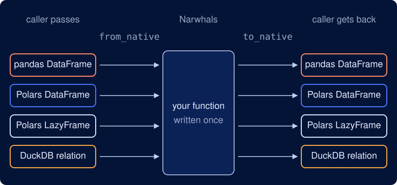

Let's say you write a Python function in Polars. But some of your teammates use pandas, and others use DuckDB. How do you make it work for everyone?

One way is to write the conditional logic to handle each library.

```python
def ffill_by_store(df):
    if isinstance(df, pd.DataFrame):
        ...  # pandas code
    elif isinstance(df, pl.DataFrame):
        ...  # Polars code
    elif isinstance(df, duckdb.DuckDBPyRelation):
        ...  # DuckDB code
    elif ...:
        ...  # one more library, one more branch
```

However, this means you need to maintain and test each branch. You also need to check that every branch gives the same answer, which takes a lot of effort.

What if you could write the function once, in Polars syntax, and have it run on all of them?

In this article, you will use Narwhals to write that function once and keep it working as these libraries change.

> 💻 **Get the Code**: The functions and tests are on [GitHub](https://github.com/khuyentran1401/codecut-blog/tree/main/narwhals-one-function-any-dataframe).

## What Is Narwhals?

[Narwhals](https://github.com/narwhals-dev/narwhals) is a lightweight layer that lets you write dataframe code in Polars syntax and run it on many libraries such as pandas, Polars, and DuckDB.

For more background on Narwhals, see [Narwhals: Unified DataFrame Functions for pandas, Polars, and PySpark](https://codecut.ai/unified-dataframe-functions-pandas-polars-pyspark/) and [Writing Portable DataFrame Code for Eager and Lazy Execution](https://codecut.ai/eager-to-lazy-dataframes-with-narwhals/).

## Setup

Install Narwhals with the libraries used in this article.

```bash
pip install "narwhals>=2.28" pandas polars duckdb pyarrow pytest datafusion
```

*This article uses narwhals v2.28.0.*

Let's create a small sales table for two stores. Each store has one missing `sales` value.

```python
from datetime import datetime

data = {
    "sale_date": [datetime(2025, 5, day) for day in (22, 23, 24, 22, 23, 24)],
    "store": ["Thimphu"] * 3 + ["Paro"] * 3,
    "sales": [1100, None, 1450, 501, 500, None],
}
```

| sale_date  | store   | sales |
| ---------- | ------- | ----- |
| 2025-05-22 | Thimphu | 1100  |
| 2025-05-23 | Thimphu | null  |
| 2025-05-24 | Thimphu | 1450  |
| 2025-05-22 | Paro    | 501   |
| 2025-05-23 | Paro    | 500   |
| 2025-05-24 | Paro    | null  |

Create the same data in each library.

```python
import duckdb
import pandas as pd
import polars as pl

df_pandas = pd.DataFrame(data)                      # pandas DataFrame
df_polars = pl.DataFrame(data)                      # Polars DataFrame, runs right away
lf_polars = pl.LazyFrame(data)                      # Polars LazyFrame, runs only when collected
duckdb_rel = duckdb.sql("SELECT * FROM df_polars")  # DuckDB relation, also lazy
```

## Accept Any DataFrame

Start with a forward-fill function in plain Polars. It fills each missing `sales` value with the previous value from the same store.

```python
import polars as pl

def ffill_by_store(df: pl.DataFrame) -> pl.DataFrame:
    return df.with_columns(
        pl.col("sales")
        .fill_null(strategy="forward")
        .over("store", order_by="sale_date")
    )
```

Apply it to a Polars DataFrame:

```python
print(ffill_by_store(df_polars))
```

```text
shape: (6, 3)
┌─────────────────────┬─────────┬───────┐
│ sale_date           ┆ store   ┆ sales │
│ ---                 ┆ ---     ┆ ---   │
│ datetime[μs]        ┆ str     ┆ i64   │
╞═════════════════════╪═════════╪═══════╡
│ 2025-05-22 00:00:00 ┆ Thimphu ┆ 1100  │
│ 2025-05-23 00:00:00 ┆ Thimphu ┆ 1100  │
│ 2025-05-24 00:00:00 ┆ Thimphu ┆ 1450  │
│ 2025-05-22 00:00:00 ┆ Paro    ┆ 501   │
│ 2025-05-23 00:00:00 ┆ Paro    ┆ 500   │
│ 2025-05-24 00:00:00 ┆ Paro    ┆ 500   │
└─────────────────────┴─────────┴───────┘
```

The two missing values now hold the previous sale from the same store. But a pandas DataFrame fails:

```python
ffill_by_store(df_pandas)
```

```text
AttributeError: 'DataFrame' object has no attribute 'with_columns'
```

To make it work for any library, change three things:

- Convert the input to a Narwhals frame with `nw.from_native`
- Use `nw.col` instead of `pl.col`
- Convert the result back with `to_native`

```python
import narwhals as nw
from narwhals.typing import IntoFrameT

def ffill_by_store(df_native: IntoFrameT) -> IntoFrameT:
    return (
        nw.from_native(df_native)  # added: convert to a Narwhals frame
        .with_columns(
            nw.col("sales")  # changed: pl.col -> nw.col
            .fill_null(strategy="forward")
            .over("store", order_by="sale_date")
        )
        .to_native()  # added: convert back to the caller's type
    )
```

Now try the same pandas DataFrame that failed before:

```python
print(ffill_by_store(df_pandas))
```

```text
   sale_date    store   sales
0 2025-05-22  Thimphu  1100.0
1 2025-05-23  Thimphu  1100.0
2 2025-05-24  Thimphu  1450.0
3 2025-05-22     Paro   501.0
4 2025-05-23     Paro   500.0
5 2025-05-24     Paro   500.0
```

It returns a pandas DataFrame with the same filled values as the Polars version without writing any pandas code.

Under the hood, `from_native` detects the library. Narwhals then translates your code into that library's own operations. `to_native` gives you back the original type.



Each input comes back as the same type it went in, so callers can keep using their own library's methods like normal down the line. Lazy inputs stay lazy, and eager inputs stay eager.

## Simplify the Conversion with a Decorator

Calling `from_native` and `to_native` adds two lines to every function. The `@nw.narwhalify` decorator does both for you, so the body stays almost the same as the original Polars code:

```python
@nw.narwhalify
def ffill_by_store(df):
    return df.with_columns(
        nw.col("sales")  # still use nw.col instead of pl.col
        .fill_null(strategy="forward")
        .over("store", order_by="sale_date")
    )
```

## Get the Same Answer on Every Library

Users expect a function to give the same answer on every library. For operations that depend on row order, Narwhals requires you to say what that order is.

To see why, compare how pandas and DuckDB handle row order.

In pandas, taking the last value per store returns the rows in the same order every time:

```python
for _ in range(2):
    print(df_pandas.groupby("store", sort=False).tail(1)[["store", "sales"]].values.tolist())
```

```text
[['Thimphu', 1450.0], ['Paro', nan]]
[['Thimphu', 1450.0], ['Paro', nan]]
```

But in DuckDB, getting the last value per store might return a different order in different runs:

```python
for _ in range(2):
    print(duckdb.sql("SELECT store, last(sales) AS sales FROM duckdb_rel GROUP BY store").fetchall())
```

```text
[('Paro', None), ('Thimphu', 1450)]
[('Thimphu', 1450), ('Paro', None)]
```

Narwhals prevents this by requiring you to specify the order to use. If you try to take the last value without specifying the order, Narwhals raises an error:

```python
def last_sale_per_store(df_native: IntoFrameT) -> IntoFrameT:
    return (
        nw.from_native(df_native)
        .group_by("store")
        .agg(nw.col("sales").last())
        .to_native()
    )

last_sale_per_store(duckdb_rel)
```

```text
InvalidOperationError: Order-dependent expressions are not supported for use in LazyFrame.

Hint: To make the expression valid, specify `order_by`.
...
 - Instead of `nw.col('price').first()` write `nw.col('price').first().over(order_by='date')`
   or `nw.col('price').first(order_by='date')`.
```

Raising an error instead of silently returning a wrong number helps you catch the problem while writing the function, not in production. To get the same answer every time, pass `order_by` to sort each store's rows by `sale_date` before taking the last one.

```python
def last_sale_per_store(df_native: IntoFrameT) -> IntoFrameT:
    return (
        nw.from_native(df_native)
        .group_by("store")
        .agg(nw.col("sales").last(order_by="sale_date"))
        .sort("store")
        .to_native()
    )

last_sale_per_store(duckdb_rel)
```

```text
┌─────────┬───────┐
│  store  │ sales │
│ varchar │ int64 │
├─────────┼───────┤
│ Paro    │  NULL │
│ Thimphu │  1450 │
└─────────┴───────┘
```

The same `order_by` works for every operation that depends on row order, such as `first()`, `cum_sum()`, `shift()`, and the forward fill in `ffill_by_store`.

## Test the Function on Every Backend

How do you test a universal function on every backend? Writing a separate assert for each library takes time and effort.

Narwhals' `assert_frame_equal` works for pandas, Polars, and DuckDB. Convert the result and the expected frame to Narwhals frames, then compare them.

```python
from narwhals.testing import assert_frame_equal

result_narwhals = nw.from_native(ffill_by_store(df))  # result as a Narwhals frame
expected_narwhals = nw.from_native(expected)          # expected as a Narwhals frame
assert_frame_equal(result_narwhals, expected_narwhals)  # compare the two
```

One way to test every library is `pytest.mark.parametrize`, which runs one test per backend:

```python
import pytest
from narwhals.testing import assert_frame_equal

expected_data = {**data, "sales": [1100, 1100, 1450, 501, 500, 500]}
expected_polars = pl.DataFrame(expected_data)


@pytest.mark.parametrize(
    "df, expected",
    [
        (df_pandas, pd.DataFrame(expected_data)),
        (df_polars, expected_polars),
        (lf_polars, expected_polars.lazy()),
        (duckdb_rel, duckdb.sql("SELECT * FROM expected_polars")),
    ],
    ids=["pandas", "polars", "polars-lazy", "duckdb"],
)
def test_ffill_by_store(df, expected):
    result_narwhals = nw.from_native(ffill_by_store(df))
    expected_narwhals = nw.from_native(expected)
    assert_frame_equal(result_narwhals, expected_narwhals)
```

Run it with `pytest -v`:

```text
test_ffill.py::test_ffill_by_store[pandas] FAILED
test_ffill.py::test_ffill_by_store[polars] PASSED
test_ffill.py::test_ffill_by_store[polars-lazy] PASSED
test_ffill.py::test_ffill_by_store[duckdb] PASSED

E   AssertionError: DataFrames are different (dtypes do not match)
    [left]: [Datetime(time_unit='us', time_zone=None), String, Float64]
    [right]: [Datetime(time_unit='us', time_zone=None), String, Int64]
```

The test passed on every backend except pandas. The pandas result has float `sales`, while the expected result has integers. This is because pandas turns the column into floats when there is `NaN` in the column.

If you had tested only on Polars and DuckDB, you would have missed this pandas problem.

To fix it, cast the column to an integer so the function returns the same type on every library.

```python
def ffill_by_store(df_native: IntoFrameT) -> IntoFrameT:
    return (
        nw.from_native(df_native)
        .with_columns(
            nw.col("sales")
            .fill_null(strategy="forward")
            .over("store", order_by="sale_date")
            .cast(nw.Int64)
        )
        .to_native()
    )
```

Run the tests again, and every backend passes.

```text
test_ffill.py::test_ffill_by_store[pandas] PASSED
test_ffill.py::test_ffill_by_store[polars] PASSED
test_ffill.py::test_ffill_by_store[polars-lazy] PASSED
test_ffill.py::test_ffill_by_store[duckdb] PASSED
```

The test is short and easy to read. If a library update breaks the function, the test will show which library causes the problem.

## Add a Library with a Plugin

What if you want to use Narwhals with a library that is not supported out of the box? Narwhals supports plugins, which allow you to add a new backend to Narwhals.

To build a plugin, a package registers itself under the `narwhals.plugins` entry point in its `pyproject.toml`:

```toml
[project.entry-points."narwhals.plugins"]
my-library = "narwhals_my_library"
```

The `narwhals_my_library` module then implements Narwhals' frame and expression methods for your library. View the [Extensions and plugins guide](https://narwhals-dev.github.io/narwhals/extending/) for more details.

Let's try `narwhals-datafusion`, a community plugin that adds [DataFusion](https://datafusion.apache.org/python/), a fast Apache query engine.

If you pass a DataFusion DataFrame to the function without the plugin, Narwhals recognizes it and tells you what to install.

```python
from datafusion import SessionContext

ctx = SessionContext()
datafusion_df = ctx.from_pydict(data)
ffill_by_store(datafusion_df)
```

```text
TypeError: Unsupported dataframe type, got: <class 'datafusion.dataframe.DataFrame'>

Hint: it looks like you passed a `datafusion.DataFrame` but don't have `narwhals-datafusion` installed.
Please refer to https://github.com/s5dsn-eqee/narwhals-datafusion for installation instructions.
```

Install the plugin based on the hint.

```bash
pip install "narwhals-datafusion==0.2.0"
```

Now the same function, with no edits, accepts the DataFusion DataFrame and returns one.

```python
from datafusion import col

result = ffill_by_store(datafusion_df)
print(type(result))
result.sort(col("store"), col("sale_date"))  # DataFusion doesn't keep row order
```

```text
<class 'datafusion.dataframe.DataFrame'>
+---------------------+---------+-------+
| sale_date           | store   | sales |
+---------------------+---------+-------+
| 2025-05-22T00:00:00 | Paro    | 501   |
| 2025-05-23T00:00:00 | Paro    | 500   |
| 2025-05-24T00:00:00 | Paro    | 500   |
| 2025-05-22T00:00:00 | Thimphu | 1100  |
| 2025-05-23T00:00:00 | Thimphu | 1100  |
| 2025-05-24T00:00:00 | Thimphu | 1450  |
+---------------------+---------+-------+
```

Plugins help in three ways:

- Supporting a new library takes one `pip install`, with no change to your functions
- You can cover the new backend by simply adding one case to your parametrized test
- Library authors can build their own plugins instead of waiting for Narwhals to add support

## Upgrade Engines Without Changing Your Code

Have you ever upgraded a library and your code broke? Recently, two major libraries, Polars 2.0 and DuckDB 2.0, changed behavior that existing code relied on. If your library supports both the old and new versions, you have to handle each change yourself, which is time-consuming and error-prone.

With Narwhals, many library upgrades don't change your results. The same code gives the same answer before and after the upgrade.

For example, in Polars 2.0, the `explode` function no longer produces a row with a null when the list is empty.

```python
promos = pl.DataFrame(
    {"store": ["Thimphu", "Paro"], "promo": [["spring", "loyalty"], []]}
)
promos.explode("promo")
```

```text
polars 1.44                      polars 2.1
┌─────────┬─────────┐            ┌─────────┬─────────┐
│ store   ┆ promo   │            │ store   ┆ promo   │
╞═════════╪═════════╡            ╞═════════╪═════════╡
│ Thimphu ┆ spring  │            │ Thimphu ┆ spring  │
│ Thimphu ┆ loyalty │            │ Thimphu ┆ loyalty │
│ Paro    ┆ null    │            └─────────┴─────────┘
└─────────┴─────────┘
```

With Narwhals, `explode` keeps the Polars 1.x behavior, even on Polars 2.1:

```python
nw.from_native(promos).explode("promo").to_native()
```

```text
┌─────────┬─────────┐
│ store   ┆ promo   │
│ ---     ┆ ---     │
│ str     ┆ str     │
╞═════════╪═════════╡
│ Thimphu ┆ spring  │
│ Thimphu ┆ loyalty │
│ Paro    ┆ null    │  ← kept on Polars 2.1
└─────────┴─────────┘
```

This way, library authors don't have to chase down bugs caused by the upgrade. If they want the new behavior, they can specify that in the code.

```python
def explode_promos(df_native: IntoFrameT) -> IntoFrameT:
    return (
        nw.from_native(df_native)
        .filter(nw.col("promo").list.len() > 0)  # drop empty lists, like Polars 2.0
        .explode("promo")
        .to_native()
    )

explode_promos(promos)
```

```text
┌─────────┬─────────┐
│ store   ┆ promo   │
│ ---     ┆ ---     │
│ str     ┆ str     │
╞═════════╪═════════╡
│ Thimphu ┆ spring  │
│ Thimphu ┆ loyalty │
└─────────┴─────────┘  ← same result as Polars 2.1
```

## Protect Your Users with stable.v2

Narwhals protects your code from changes in pandas, Polars, and DuckDB. But Narwhals' own API can change too, so a Narwhals upgrade could break your code or change its output. To prevent this, import from `narwhals.stable.v2`. Narwhals promises never to change or remove any public function in this namespace.

```python
import narwhals.stable.v2 as nw
```

So import from `narwhals.stable.v2` in code that other people run. In code only you run, import from `narwhals` to get the newest features.

## Final Thoughts

Overall, Narwhals lowers the cost of supporting many libraries, even as they change. You write a function once, your users keep the library they prefer, and upgrades need little extra work.