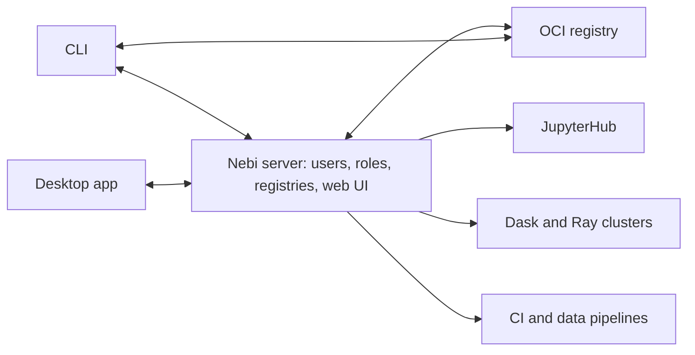

[Nebi](https://github.com/nebari-dev/nebi) is an open-source tool for managing [Pixi](https://pixi.sh) environments across a team. It keeps a version history of every environment, shares environments through a server or any OCI registry, and controls who can change them. It ships as a CLI, a desktop app and a multi-user server.

Nebi is in alpha. This post covers the problem it solves, how to use it, and the design decisions behind it.


## What teams need beyond Pixi

If your project needs compiled libraries such as GDAL, CUDA or MPI, `pip install` often isn't enough. Pixi solves this by resolving conda-forge and PyPI packages into one lock file, so an environment with compiled system libraries installs the same way on every machine.

For one developer, that is most of the problem. You commit `pixi.toml` and `pixi.lock` to git and you have a reproducible environment.

Teams need three more things:

- **Sharing.** The same environment has to reach a colleague's laptop, a JupyterHub server, a CI pipeline and a Dask cluster. A git repo works for developers, and it doesn't reach a scientist who doesn't use git or a platform that doesn't clone repos.
- **Control.** Research environments change daily, and production environments need to be locked down. Someone has to decide who can change which environment and which version is the approved one.
- **History.** You need the lock file to reproduce an environment exactly, and the spec file to understand and change it. A `pixi.toml` with eight packages can resolve to a lock file of around 7,500 lines. Keeping the two in sync over months of changes, and getting back to last month's version, needs both versioned together.

Most organizations answer these with approved container images and a change request process. That is slow, since a single package upgrade can take days. Storage is expensive too, because every small package change produces a new image of several gigabytes. Pixi plus git doesn't scale either: one repo can't cleanly hold many environments, and one repo per environment needs automation permissions most teams don't have.

## What Nebi adds

Nebi builds on Pixi. It doesn't re-implement dependency resolution, it calls Pixi to do that, and adds the team layer around it:

- **Versioned environments.** Every push stores the `pixi.toml` and `pixi.lock` pair as a new version, tagged with a content hash, a moving `latest`, and any tag you choose. You can diff two versions and pull any earlier one.
- **A team server.** Environments live in workspaces, with owner, editor and viewer roles per workspace for users or groups. Users can sign in through any OIDC identity provider, and their groups sync from it.
- **Distribution through OCI registries.** Publish an environment to Quay, GHCR or a self-hosted registry, and import it from there, with or without a Nebi server.
- **Bundled files.** A small set of scripts, configs or READMEs can travel with the environment.
- **Jupyter integration.** With [nb-nebi-kernels](https://github.com/nebari-dev/nb-nebi-kernels), every Nebi workspace shows up as a Jupyter kernel, including ones on the server that haven't been pulled yet.
- **Three interfaces.** A CLI, a desktop app for people who don't work in a terminal, and a web UI on the server.

## Using Nebi

Install the CLI and desktop app with Pixi:

```bash
pixi global install nebi
```

### Track an environment

`nebi init` tracks a Pixi project, and runs `pixi init` first if the directory doesn't have one yet:

```bash
cd my-project
nebi init
nebi workspace list
```

Once tracked, you can activate any workspace by name from any directory:

```bash
nebi shell my-project
```

### Share it through a server

Log in to your team's Nebi server and push:

```bash
nebi login https://nebi.example.com
nebi push my-project:v1.0
```

Each push gets a `sha-<hash>` tag computed from the manifest and lock file, plus `latest`, plus your tag if you give one. Pushing the same content twice doesn't create a new version.

A colleague pulls it on another machine:

```bash
nebi pull my-project:v1.0
```

### See what changed, and go back

```bash
nebi workspace tags my-project
nebi diff my-project:v1.0 my-project:v2.0
nebi diff --lock
```

If v2.0 breaks something, pulling `my-project:v1.0` puts the earlier spec and lock file back.

### Publish to an OCI registry

Add a registry once, then publish:

```bash
nebi publish my-project --tag v1.0.0
```

Anyone with access to the registry can import it, without a Nebi server:

```bash
nebi import quay.io/my-org/my-project:v1.0.0 -o ./my-project
```

The [CLI guide](https://nebi.nebari.dev/docs/cli-team) covers every command, and [Server Setup](https://nebi.nebari.dev/docs/server-setup) covers running your own server.


## How the pieces fit



The server holds `pixi.toml`, `pixi.lock` and any bundled files. The CLI and desktop app push and pull them, and so can an OCI registry. A typical flow: build an environment interactively in JupyterHub, then send the same environment to a Dask cluster for a large run, or to a CI pipeline.

Pixi supports multi-platform solves, so an environment created on [Nebari](https://www.nebari.dev/), which runs on Linux, can be pulled onto a Mac. The result is an equivalent environment, not an identical one, and some environments can't be solved on every platform.

## Design decisions

### OCI registries as a distribution format

OCI, the Open Container Initiative, is the standard container images are built on, but an OCI registry can store any artifact, and you get tagging and versioning with it. Nebi publishes an environment as an OCI artifact: the `pixi.toml` and `pixi.lock` in their own layers, plus optional layers for bundled files. Almost every organization already has an approved way to pull from an OCI registry, so environments travel through infrastructure that already exists. Storing a spec and lock file per version is also far smaller than a container image per version.

### The server is optional

The server exists for access control: who can see an environment, who can change it, and which version `latest` points to. Some teams have environments tied to private projects, or to an internal package mirror, that only some people should see. If you only need to hand an environment to someone, an OCI registry is enough, and a public registry is the simplest way to share outside your organization.

### Nebi holds environments, other tools deploy them

On Kubernetes, there are several ways to get an environment onto every pod: a shared volume mounted on all of them, environments in each user's home directory, or a container built from the environment and pushed to an internal registry. Each has tradeoffs. We decided Nebi's job is to store environment specs and let you pull them. Turning a spec into something running on a cluster belongs to a separate tool, which we are designing as part of the Nebari ecosystem.

### One Go binary

We wanted a single binary that is easy to install everywhere. Go gave us that, and [Wails](https://wails.io/) gives the desktop app a native feel on macOS and Windows from the same codebase.

## What's next

Nebi is alpha, and early users have shown us where it needs work:

- **Cross-platform defaults.** Nebi does what Pixi does, and by default targets both macOS and Linux. We want that choice to be explicit in the UI and CLI.
- **Updating environments under running kernels.** Updating an environment while someone's Jupyter kernel has it loaded can leave half-imported packages. nb-nebi-kernels already compares the local and server versions of a workspace, and marks a kernel as outdated while still launching the local copy. We are working out how a running session should move to the new version.
- **Clearer concepts.** A spec can live locally, on a server or in a registry, and pulling a spec is a separate step from installing the environment it describes. We are still working out how to present these so that a scientist who "downloaded" an environment isn't surprised it isn't installed yet.

## Try it

```bash
pixi global install nebi
```

Dharhas Pothina introduced Nebi at The Python Exchange in August 2026, including a live demo of the web UI, the CLI, the desktop app and Jupyter integration. The [recording is on YouTube](https://www.youtube.com/watch?v=rCa3zztvbJk).

We would like your feedback. Open an issue on [GitHub](https://github.com/nebari-dev/nebi/issues) when something doesn't fit how your team works.
