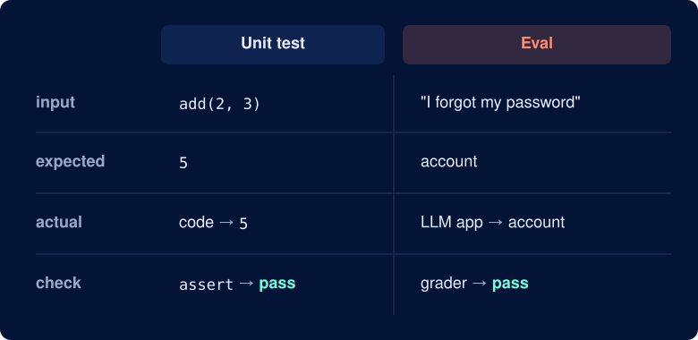
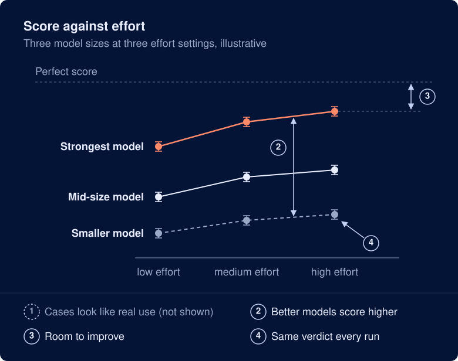
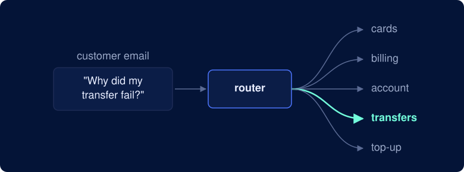
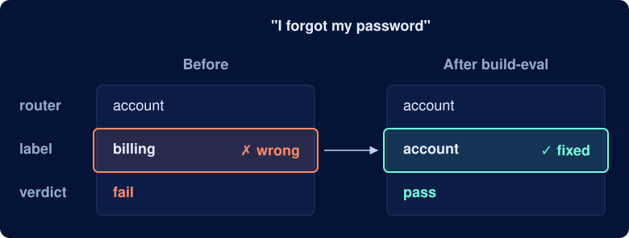
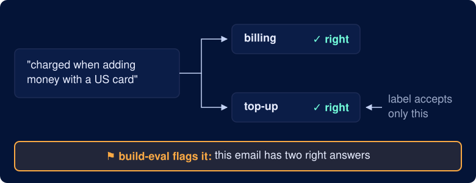
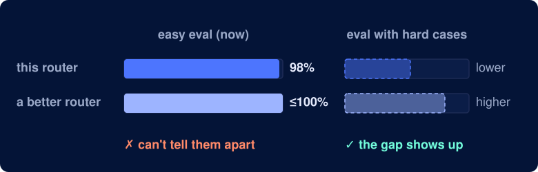
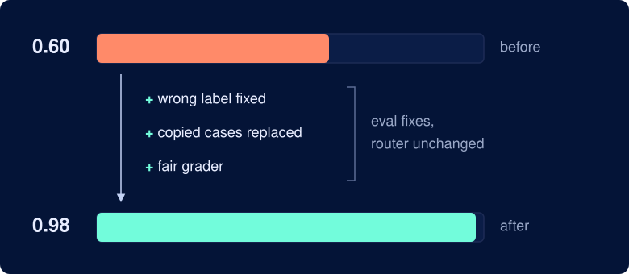
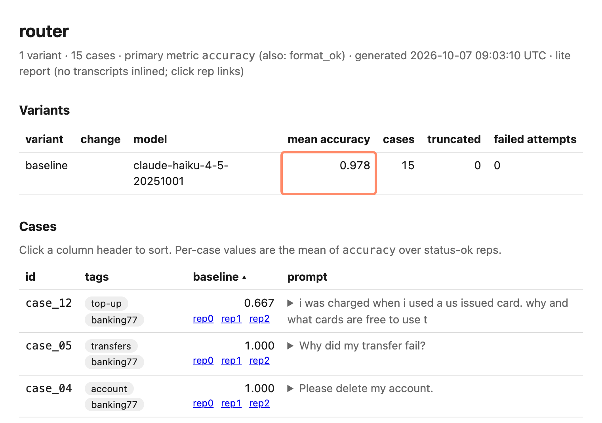

What if your LLM app's evaluation score improved because of problems in the evaluation, not because the app got better?

A wrong label, an unfair grader, or test cases that are too easy can make a weak app look strong, or a strong one look weak.

Claude Code recently added `/claude-api build-eval`, a command that checks an eval for these problems. To see how well it works, I built a small eval for an email router, hid 5 bugs in it, and ran the command. This article shows what it found and what it was like to use.

The code for this experiment is in the [companion folder](https://github.com/khuyentran1401/codecut-blog/tree/main/planted-bugs-build-eval).

## What makes an eval good

An eval is the LLM version of a unit test suite. Each part has a unit-test counterpart:

- **Inputs**, such as customer emails, are the test inputs.
- **Expected answers** are the expected outputs.
- **The LLM's responses** are the actual outputs.
- **A grader** decides whether each response is right, like an assertion.



So what makes an eval good? The [Claude blog post that introduced build-eval](https://claude.dev/blog/automating-eval-design-and-hillclimbing/) gives 4 signs of a well-designed eval that you should look for:

1. **The test cases look like what users send.** If the cases are easier than real ones, a high score does not show how well the app handles real users' emails.
2. **Better models score higher.** A stronger model should do better than a weaker one. When it doesn't, there is likely a problem with the eval.
3. **There is room to improve.** Include cases hard enough that even the best model scores well below 100%. Otherwise a better prompt can't raise the score.
4. **The same answer gets the same verdict.** The grader should score the same answer the same way on every run. Otherwise, a change in the score may be just noise, not a sign that the app got better.



*Adapted from Figure 1 in [Automating eval design and hillclimbing with Claude](https://claude.dev/blog/automating-eval-design-and-hillclimbing/).*

This article tests the first, third, and fourth signs.

## Meet build-eval

`build-eval` is part of [claude-api](https://github.com/anthropics/skills/tree/main/skills/claude-api), the Claude Code skill for apps that use the Claude API.

To run it, open Claude Code in your app's folder and type:

```text
/claude-api build-eval
```

If you already have an eval, it:

- Checks your test cases and grader for problems
- Fixes the ones you approve
- Runs the eval and reports the score

## Setup

I tested an email router for a bank's support team. It reads a customer email and sends it to one of 5 queues: `cards`, `billing`, `account`, `transfers`, or `top-up`.



To test it, I took 15 customer emails from the [Banking77](https://huggingface.co/datasets/PolyAI/banking77) dataset and labeled each with a queue. Then I planted 5 bugs in the eval, without telling `build-eval` where they were.

I used two models:

- Claude Haiku 4.5 for the router and the eval's original grader
- Claude Opus 5.5 to run `build-eval`

## What build-eval found

`build-eval` found all 5 bugs. Below is each bug I planted and what `build-eval` recommended.

### It fixed the wrong label

I labeled one email wrong on purpose. "I forgot my password" belongs in the `account` queue, but I labeled it `billing`.

So even when the router picks the right queue, the eval marks it wrong.

`build-eval` found that the label was wrong and recommended relabeling it from `billing` to `account`:

```text
case_09 "I forgot my password" is labeled billing. Change it?
1. Relabel to account (Recommended)
   Password/login issues belong with account management.
2. Keep billing
   Your bank genuinely routes password resets to billing.
```




### It replaced the leaked test cases

I leaked 3 test emails into the router's prompt as examples, with their answers. The router already knows those answers, so passing them is cheating.

`build-eval` named all 3 leaked emails and recommended replacing them with new ones:

```text
case_03, case_07, case_11 are copied word for word from the prompt's examples.
How should I handle them?
1. Replace with new cases (Recommended)
2. Keep, tag as in-prompt
3. Change the prompt examples
```


### It flagged the email with two right answers

I added an email with two right answers: `billing` and `top-up`. Its label accepts only `top-up`, so a router that picks `billing` is marked wrong.

`build-eval` flagged that email:

```text
case_12 mentions a charge but is about adding money, so it could go to either billing or top-up.
```



### It replaced the flaky grader

I wrote a flaky grader: an LLM scores each answer from 1 to 5, and only a 5 passes. The same answer can score 5 on one run and 4 on the next, so its verdict can flip without the answer changing.

With a grader like this, you can't tell whether a change in the score means the app got better, got worse, or is just noise.

`build-eval` flagged that this LLM judge is flaky and recommended replacing it with a code check:

```text
How should the queue choice be graded?
1. Code check (Recommended)
   Parse the `Queue:` line, normalize case/whitespace, exact-match expected.
   Free, deterministic.
2. Keep the LLM judge
   Current 1-5 holistic score, pass only at 5.
   Non-deterministic and blends queue with reason quality.
```


A code check works better than an LLM judge here. It only compares the queue name with the expected one, so it gives the same verdict every time.

Here is a simplified version of the new check:

```python
queue = re.search(r"queue:\s*(.+)", answer, re.IGNORECASE).group(1)  # read the Queue: line
queue = queue.strip().lower()                                        # "Account " -> "account"
passed = queue == expected                                           # exact match
```

### It warned the eval was too easy

I filled the eval with easy emails. In 12 of the 15 emails, one word gives away the answer. For example, "How do I track my card?" contains "card", so it goes to `cards`.

Because of this, even a weak router scores high, and a better prompt has little room to raise the score.

`build-eval` caught this bug from the score, not the emails. The router scored 98%, so a better prompt would have almost no room to show up:

```text
This eval is close to its ceiling. There are 2 points of room above the
baseline, but the margin of error is ±4 points. That means it can catch a
change that makes routing worse, so it works as a regression check before you
change the prompt or model. It can't show a change that makes routing better.
```



## Before and after build-eval

When `build-eval` finished, the score had jumped from 0.60 to 0.98. Since the router's prompt and model never changed, the gain must have come from fixing the eval.



It also built an HTML report of the run that shows the overall score, each case's score across its 3 runs, and a link to every transcript, so you can see which case failed and read why:



## Final thoughts

In this experiment, `build-eval` found all 5 bugs, but what I liked most is that it asked before changing anything. Each problem came with a recommended fix and an option to keep things as they were, in case a "bug" was on purpose.

The report then let me go through each case and see exactly what the router did.

If you're building an eval, or unsure about one you have, run `build-eval` on it first.

## Try it yourself

To try it yourself, copy the broken eval out of the [companion folder](https://github.com/khuyentran1401/codecut-blog/tree/main/planted-bugs-build-eval) and run the command in a fresh Claude Code session:

```bash
cp -r notebooks/planted-bugs-build-eval/eval ~/router-eval
cd ~/router-eval
python3 run_eval.py         # the starting score, about 0.60
claude                      # then run /claude-api build-eval
```

## References

- **[Automating eval design and hillclimbing with Claude](https://claude.dev/blog/automating-eval-design-and-hillclimbing/)** (Lance Martin, 2026): introduces `build-eval` and the checks it runs; every example in it starts from an eval the authors trusted.