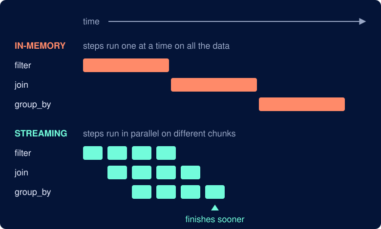
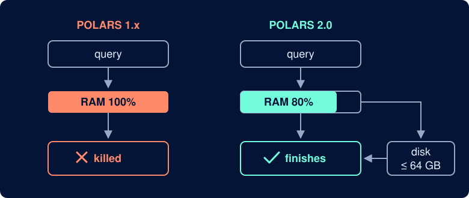
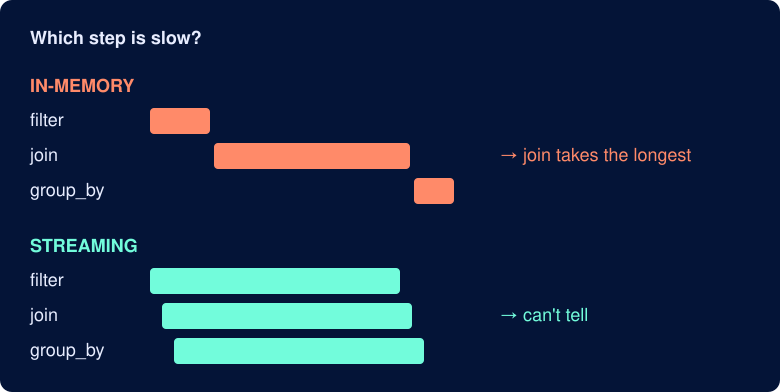

[Polars 2.0](https://pola.rs/posts/release-polars-2) came out on October 6, 2026. The Polars team calls it a "boring" release because it mostly changes defaults instead of adding new APIs.

But boring doesn't mean minor. I think this release is exciting for two reasons:

- Your code gets faster without any changes.
- Polars now stops with an error instead of running with unexpected behavior, so you catch bugs early instead of debugging them later.

This post compares each change in Polars 1.x and 2.0 and explains why it matters.

## The Streaming Engine Is the Default

### Faster collect() With No Code Changes

In Polars 2.0, `collect()` runs lazy queries on the streaming engine instead of the in-memory engine.

To see why this matters, here is the difference between the two engines:

- in-memory: Runs each step on all the data before starting the next one
- streaming: Splits the data into chunks and passes each chunk through all the steps, so steps overlap

The figure below shows how each engine runs a query with three steps: filter, join, and group_by.



Because the steps overlap, the same query can finish sooner. To measure how much, download one month of [NYC taxi trips](https://www.nyc.gov/site/tlc/about/tlc-trip-record-data.page) and the zone lookup table:

```bash
curl -o taxi.parquet https://d37ci6vzurychx.cloudfront.net/trip-data/yellow_tripdata_2024-01.parquet
curl -o taxi_zones.csv https://d37ci6vzurychx.cloudfront.net/misc/taxi_zone_lookup.csv
```

*This post uses polars v2.0.0. The 1.x comparisons use polars v1.44.2.*

The query below joins about 3 million trips to their pickup zones, then summarizes tips and trip lengths by borough and hour:

```python
import polars as pl

trips = pl.scan_parquet("taxi.parquet")
zones = pl.scan_csv("taxi_zones.csv")

query = (
    trips.filter(pl.col("fare_amount") > 0, pl.col("trip_distance") > 0)
    .join(zones, left_on="PULocationID", right_on="LocationID")
    .with_columns(
        tip_rate=pl.col("tip_amount") / pl.col("fare_amount"),
        hour=pl.col("tpep_pickup_datetime").dt.hour(),
        minutes=(
            pl.col("tpep_dropoff_datetime") - pl.col("tpep_pickup_datetime")
        ).dt.total_minutes(),
    )
    .group_by("Borough", "hour")
    .agg(
        pl.len().alias("trips"),
        pl.col("tip_rate").median(),
        pl.col("minutes").quantile(0.9),
        pl.col("total_amount").sum(),
    )
    .sort("Borough", "hour")
)

summary = query.collect()
```

Running `query.collect()` 5 times in fresh processes on each Polars version and taking the median gives:

```text
                 time     peak memory
polars 1.44.2    75 ms    564 MB
polars 2.0.0     52 ms    797 MB    <- 1.4x faster, but more memory
```

The same code runs about 1.4 times faster after the upgrade. You get this speed-up with no code changes.

Peak memory went up, which is expected because the streaming engine holds many chunks in memory at once. On a typical laptop with 16 GB of RAM or more, you won't notice the extra 233 MB.

### Spill-to-Disk Is On

In Polars 1.x, the in-memory engine had to fit all the data in RAM. If it didn't fit, the query crashed, often taking the whole Python process with it.

Polars 2.0 instead writes intermediate data to disk when memory use reaches about 80% of RAM, so the query can finish. By default, it uses up to 64 GB of disk space for this.



This covers sorts, window functions, and many expressions. Joins and group-bys can't spill yet, but the Polars team plans to add them next.

### Joins No Longer Keep Row Order

The streaming engine finishes chunks in whatever order they're ready. Because of that, a join or group-by no longer returns rows in the input order.

To see this, number each trip with `with_row_index`, join it to the zones, and look at the first 5 rows:

```python
joined = (
    trips.with_row_index("row")
    .join(zones, left_on="PULocationID", right_on="LocationID")
    .select("row", "tpep_pickup_datetime", "Zone")
)
joined.head(5).collect()
```

Polars 1.44.2 returns the first 5 trips of the file:

```text
┌─────┬──────────────────────┬──────────────────────────────┐
│ row ┆ tpep_pickup_datetime ┆ Zone                         │
╞═════╪══════════════════════╪══════════════════════════════╡
│ 0   ┆ 2024-01-01 00:57:55  ┆ Penn Station/Madison Sq West │
│ 1   ┆ 2024-01-01 00:03:00  ┆ Lenox Hill East              │
│ 2   ┆ 2024-01-01 00:17:06  ┆ Upper East Side North        │
│ 3   ┆ 2024-01-01 00:36:38  ┆ East Village                 │
│ 4   ┆ 2024-01-01 00:46:51  ┆ SoHo                         │
└─────┴──────────────────────┴──────────────────────────────┘
```

Polars 2.0 doesn't return the first 5 trips, and each run can return a different set of rows:

```text
┌─────────┬──────────────────────┐
│ row     ┆ tpep_pickup_datetime │
╞═════════╪══════════════════════╡
│ 734007  ┆ 2024-01-09 20:06:43  │
│ 734013  ┆ 2024-01-09 20:41:13  │
│ 734033  ┆ 2024-01-09 20:43:48  │
│ …       ┆ …                    │
└─────────┴──────────────────────┘
```

No error is raised. If your code expects `head()` after a join to return the first rows, it now gets random rows instead.

To get the first rows back, sort the result before taking them:

```python
joined.sort("row").head(5).collect()
```

```text
┌─────┬──────────────────────┬──────────────────────────────┐
│ row ┆ tpep_pickup_datetime ┆ Zone                         │
╞═════╪══════════════════════╪══════════════════════════════╡
│ 0   ┆ 2024-01-01 00:57:55  ┆ Penn Station/Madison Sq West │
│ 1   ┆ 2024-01-01 00:03:00  ┆ Lenox Hill East              │
│ 2   ┆ 2024-01-01 00:17:06  ┆ Upper East Side North        │
│ 3   ┆ 2024-01-01 00:36:38  ┆ East Village                 │
│ 4   ┆ 2024-01-01 00:46:51  ┆ SoHo                         │
└─────┴──────────────────────┴──────────────────────────────┘
```

Keep in mind that sorting can increase query time and memory usage. For the median of 5 runs, sorting makes the query 1.5 times slower and uses about 50% more memory:

```text
                              time     peak memory
polars 2.0.0                  20 ms    280 MB
polars 2.0.0, .sort("row")    30 ms    416 MB    <- 1.5x slower, more memory
```

### SQL Runs on the Streaming Engine

In 2.0, SQL queries also run on the streaming engine by default, so the speed-up and the row-order change above apply to them too.

To measure the difference, I ran this query 5 times on each version and took the median:

```python
trips = pl.scan_parquet("taxi.parquet").with_row_index("row")
zones = pl.scan_csv("taxi_zones.csv")

query = """
SELECT Borough, COUNT(*) AS trips, AVG(tip_amount / fare_amount) AS tip_rate
FROM trips
JOIN zones ON trips.PULocationID = zones.LocationID
WHERE fare_amount > 0 AND trip_distance > 0
GROUP BY Borough
ORDER BY Borough
"""
summary = pl.sql(query).collect()
```

Polars 2.0 runs this query 2.8 times faster than Polars 1.44.2, and uses less memory:

```text
                 time     peak memory
polars 1.44.2    55 ms    490 MB
polars 2.0.0     20 ms    358 MB    <- 2.8x faster, 27% less memory
```

Joins in SQL now return rows in a different order on each run, just like in Python:

```python
query = """
SELECT row, Zone
FROM trips
JOIN zones ON trips.PULocationID = zones.LocationID
LIMIT 3
"""
pl.sql(query).collect()
```

Polars 2.0 returns different trips on each run:

```text
first run
┌────────┬───────────────────────┐
│ row    ┆ Zone                  │
╞════════╪═══════════════════════╡
│ 314661 ┆ Midtown East          │
│ 314671 ┆ Upper East Side South │
│ 314743 ┆ Midtown East          │
└────────┴───────────────────────┘

second run
┌─────┬────────────────────────────────┐
│ row ┆ Zone                           │
╞═════╪════════════════════════════════╡
│ 300 ┆ Stuy Town/Peter Cooper Village │
│ 333 ┆ Outside of NYC                 │
│ 355 ┆ Stuy Town/Peter Cooper Village │
└─────┴────────────────────────────────┘
```

Add `ORDER BY` if you need the rows in a stable order:

```python
query = """
SELECT row, Zone
FROM trips
JOIN zones ON trips.PULocationID = zones.LocationID
ORDER BY row
LIMIT 3
"""
pl.sql(query).collect()
```

```text
┌─────┬──────────────────────────────┐
│ row ┆ Zone                         │
╞═════╪══════════════════════════════╡
│ 0   ┆ Penn Station/Madison Sq West │
│ 1   ┆ Lenox Hill East              │
│ 2   ┆ Upper East Side North        │
└─────┴──────────────────────────────┘
```

### LazyFrame.profile() Is Removed

In Polars 1.x, you could use `profile()` to find which step was slow, because steps ran one after another.

In Polars 2.0, the streaming engine is the default, so steps run at the same time. Their timings overlap, and Polars can't tell you which step is slow:



So Polars 2.0 removes the method. There is no replacement in open-source Polars yet, but the Polars team [is working on one](https://docs.pola.rs/releases/upgrade/2/).

### Switch Back to the In-Memory Engine

If a query still depends on the in-memory engine's behavior, you can switch back to it for that query:

```python
summary = query.collect(engine="in-memory")
```

Or make it the default for every `collect()` that follows:

```python
pl.Config.set_engine_affinity("in-memory")
```

Note that this doesn't bring back `profile()`, which is removed in 2.0.

## Stricter Types: Fewer Silent Conversions

Polars 1.x converted between some types on its own, sometimes losing information along the way. Polars 2.0 either keeps the exact value or raises an error.

### Casting Strings to Dates

The `cast` method converts a column from one type to another, such as `Int32` to `Int64`. In Polars 1.x, it could also convert strings to dates:

```python
dates = pl.DataFrame({"pickup_date": ["01/15/2024", "01/16/2024"]})
dates.with_columns(pl.col("pickup_date").cast(pl.Date))
```

But `cast` only reads strings in the `YYYY-MM-DD` format. Any other format raises an error:

```text
InvalidOperationError: conversion from `str` to `date` failed in column 'pickup_date'
for 2 out of 2 values: ["01/15/2024", "01/16/2024"]
```

To stop `cast` from assuming a format, Polars 2.0 drops support for casting strings to date and time types. Instead, you state the format with the matching `str` method, such as `str.to_date`:

```python
dates.with_columns(pl.col("pickup_date").str.to_date("%m/%d/%Y"))
```

```text
┌─────────────┐
│ pickup_date │
│ ---         │
│ date        │
╞═════════════╡
│ 2024-01-15  │
│ 2024-01-16  │
└─────────────┘
```

### Adding Large Integers Without Rounding

Adding a signed integer (one that allows negatives) and an unsigned one (one that doesn't) used to produce a float. Floats can't store very large integers exactly, so large values were rounded.

For IDs, even a small rounding error is a big problem, because it usually goes unnoticed. For example:

```python
ids = pl.DataFrame({
    "trip_id": pl.Series([2**53 + 1], dtype=pl.Int64),  # 9007199254740993
    "offset": pl.Series([0], dtype=pl.UInt64),
})
ids.select(pl.col("trip_id") + pl.col("offset")).item()
```

```text
polars 1.44.2   9007199254740992.0   Float64   <- ID is off by one
```

Polars 2.0 uses `Int128` instead. It's still an integer, so nothing is rounded, and it's wide enough to hold both negative numbers and very large positive ones:

```text
polars 2.0.0    9007199254740993     Int128    <- ID is exact
```

This means IDs stay exact after arithmetic, so joins and lookups on them still match the right rows.

### Matching Integers Against Floats in is_in

Polars 1.x let you filter an integer column with a list of floats, or a float column with integers. Polars 2.0 no longer allows either:

| Column    | `is_in` values | Polars 1.x | Polars 2.0 |
| --------- | -------------- | ---------- | ---------- |
| `Float64` | floats         | ✅         | ✅         |
| `Int32`   | integers       | ✅         | ✅         |
| `Int32`   | floats         | ✅         | ❌         |
| `Float64` | integers       | ✅         | ❌         |

With small numbers, mixing them seems harmless. In Polars 1.x, looking up an ID with a float returns the right user:

```python
users = pl.DataFrame({"user_id": [101, 102, 103]})
lookup = [float(102)]  # [102.0]
users.filter(pl.col("user_id").is_in(lookup))
```

```text
┌─────────┐
│ user_id │
╞═════════╡
│ 102     │
└─────────┘
```

But with large IDs, the same lookup returns the wrong rows. Floats can't store 19-digit integers exactly, so nearby IDs all round to the same value:

```python
users = pl.DataFrame(
    {"user_id": [1234567890123456789, 1234567890123456790, 1234567890123456800]}
)
lookup = [float(1234567890123456789)]
users.filter(pl.col("user_id").is_in(lookup))
```

Polars 1.44.2 returns three users for one ID:

```text
lookup ID: ...456789

┌───────────┐
│ user_id   │
╞═══════════╡
│ ...456789 │   <- matches
│ ...456790 │   <- not asked for
│ ...456800 │   <- not asked for
└───────────┘
```

Polars 2.0 refuses to compare an integer column with float values, so the same code raises an error instead:

```text
InvalidOperationError: 'is_in' cannot check for Int64 values in List(Float64) data.
```

This behavior is ideal. It's better to get an error now than to spend hours later debugging a silent bug.

To clear the error, make sure the lookup holds integers, not floats:

```python
lookup = [1234567890123456789]
users.filter(pl.col("user_id").is_in(lookup))
```

## Other API Changes

### explode Drops Empty Lists

`explode` turns each item in a list into its own row, so an empty list should produce no rows. Polars 1.x added a `null` row instead:

```python
stops = pl.DataFrame({"trip": [1, 2], "stops": [[10, 11], []]})
stops.explode("stops")
```

```text
┌──────┬───────┐
│ trip ┆ stops │
╞══════╪═══════╡
│ 1    ┆ 10    │
│ 1    ┆ 11    │
│ 2    ┆ null  │
└──────┴───────┘
```

In Polars 2.0, the empty list produces no rows, as you'd expect:

```text
┌──────┬───────┐
│ trip ┆ stops │
╞══════╪═══════╡
│ 1    ┆ 10    │
│ 1    ┆ 11    │
└──────┴───────┘
```

Pass `empty_as_null=True` to keep the old behavior:

```python
stops.explode("stops", empty_as_null=True)
```

```text
┌──────┬───────┐
│ trip ┆ stops │
╞══════╪═══════╡
│ 1    ┆ 10    │
│ 1    ┆ 11    │
│ 2    ┆ null  │
└──────┴───────┘
```

### qcut Is Deprecated

`qcut` is deprecated, likely because it can behave unexpectedly.

Let's say you want to compare low and high tippers by splitting the tips into 4 groups of the same size using `qcut(4)`:

```python
tips = pl.DataFrame({"tip": [0.0, 0.0, 0.0, 0.0, 0.0, 0.0, 1.0, 2.0, 3.0, 5.0]})
tips.with_columns(group=pl.col("tip").qcut(4))
```

`qcut(4)` cuts the sorted tips at the 25%, 50% and 75% marks. Since six of the ten tips are 0, the 25% and 50% cut points are both 0. Instead of 4 groups of near-equal size, the second group would be empty:

```text
sorted tips:  0  0  0  0  0  0  1  2  3  5
                     ▲      ▲     ▲
                    25%    50%   75%
cut points:          0      0   1.75

wanted:  [0 0 0] [0 0 0] [1 2] [3 5]      4 groups of near-equal size
qcut:    [0 0 0 0 0 0] [ ] [1] [2 3 5]    group 2 is empty ❌
```

That empty group is a range from 0 to 0, which no value can fall into, so Polars 1.44.2 raises an error.

`qcut` decides groups by *value*, so identical tips can never be split across groups. Polars 2.0 adds `bin_ranks`, which decides groups by *position* in sorted order, so you get 4 groups of nearly equal size:

```python
tips.with_columns(
    group=pl.col("tip").bin_ranks(4, labels=["q1", "q2", "q3", "q4"])
).group_by("group").len().sort("group")
```

```text
┌───────┬─────┐
│ group ┆ len │   <- len = number of tips in each group
╞═══════╪═════╡
│ q1    ┆ 3   │
│ q2    ┆ 3   │
│ q3    ┆ 2   │
│ q4    ┆ 2   │
└───────┴─────┘
```

`bin_ranks` splits the six 0 tips across the first two groups, so no group is left empty:

```text
sorted tips:  0  0  0  0  0  0  1  2  3  5

qcut:         [0 0 0 0 0 0] [ ] [1] [2 3 5]    group 2 is empty ❌
bin_ranks:    [0 0 0] [0 0 0] [1 2] [3 5]      4 groups of near-equal size ✅
```

## Final Thoughts

What I like most about Polars 2.0 is that your code gets faster without changing a single line.

Many changes also make methods specific to their use case, which prevents unexpected behavior. I like this because it saves users from debugging silent bugs later.

Of course, this means your code may start raising some errors after you upgrade. Fixing them now is worth it, because it's far cheaper to fix a known bug than to debug a silent one in production.

## References

- **[Release of Polars 2.0](https://pola.rs/posts/release-polars-2)** (Ritchie Vink, 2026): release date, spill-to-disk threshold and disk budget, and SQL changes.
- **[Pre-release of Polars 2.0](https://pola.rs/posts/announcing-polars-2)** (Ritchie Vink, 2026): why the version bump, and which operations lose row order on the streaming engine.
- **[Polars 2 upgrade guide](https://docs.pola.rs/releases/upgrade/2/)** (Polars, 2026): the full list of breaking changes covered in this article.
- **[py-2.0.0 release notes](https://github.com/pola-rs/polars/releases/tag/py-2.0.0)** (Polars, 2026): changelog and performance changes.
