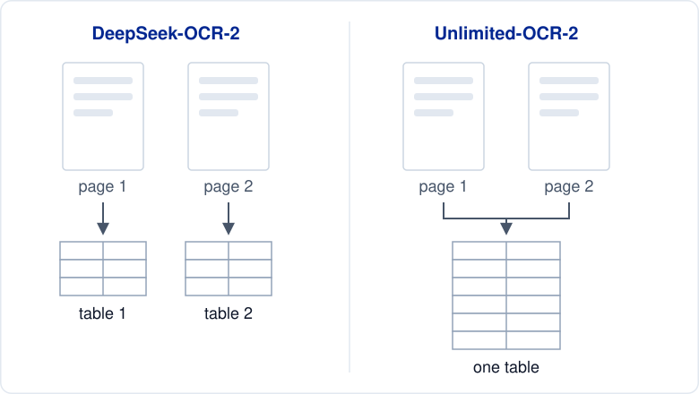
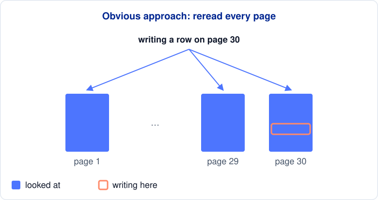
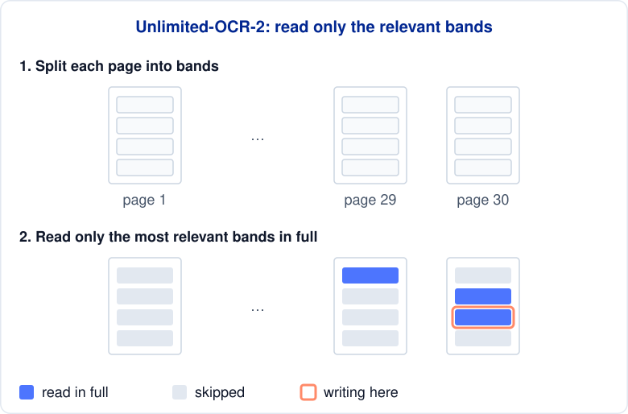
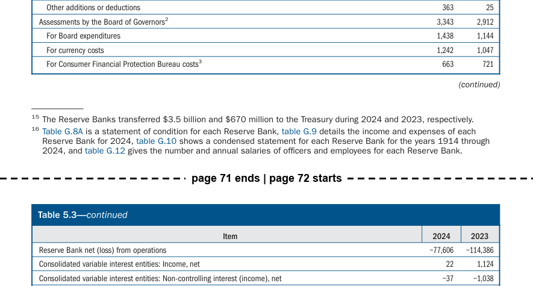
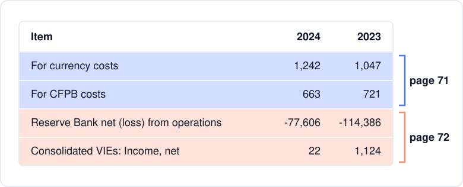
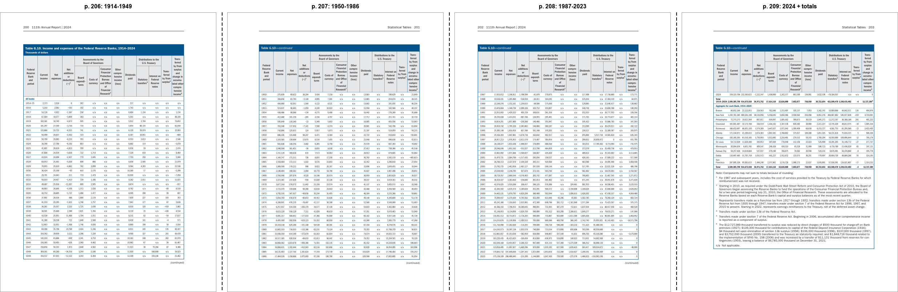
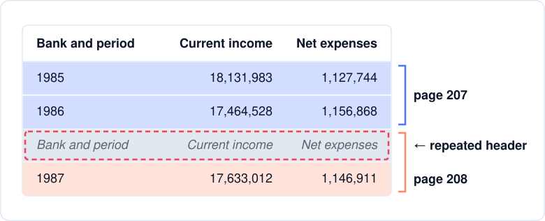
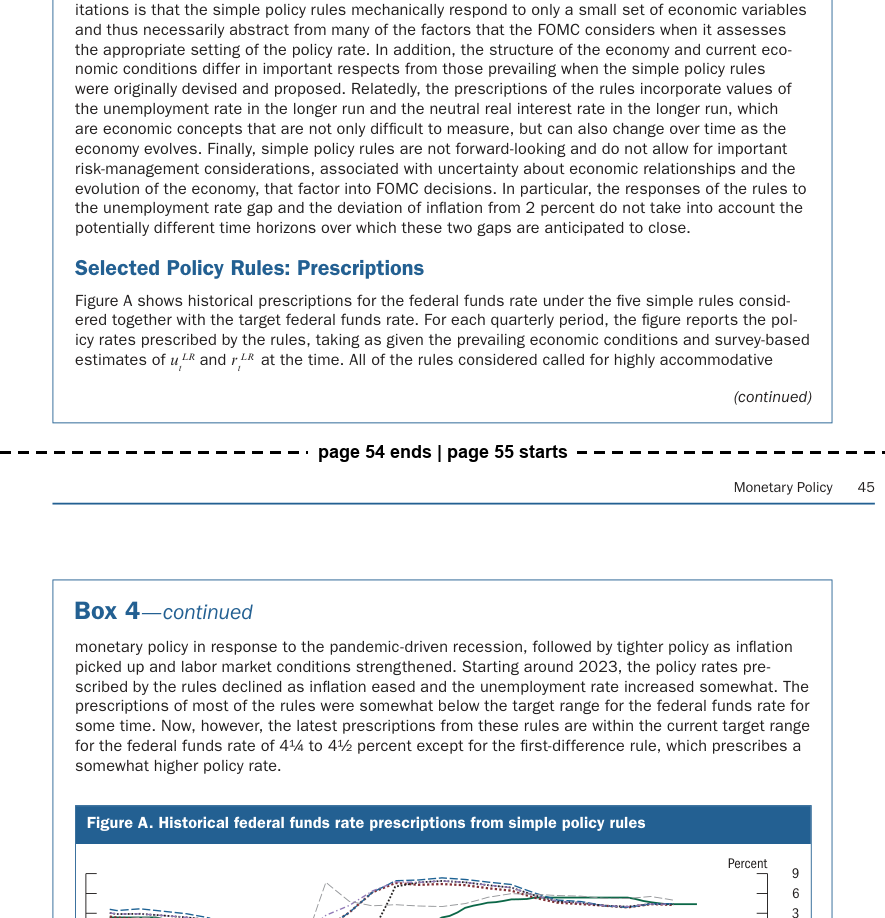

If you run OCR on a long PDF report, a table that spans two pages may come back as two separate tables instead of one. This happens because most OCR models read one page at a time, so the model has no idea the two halves belong to the same table.

Unlimited-OCR-2 solves this by reading many pages in one request, so the model can see where a table continues onto the next page.

It scores well on [long-document benchmarks](https://huggingface.co/baidu/Unlimited-OCR-2/blob/main/Unlimited-OCR-2.pdf), but benchmarks don't always reflect real-world documents. So I tested it on a long PDF report to see how good it is in practice.

> 💻 **Get the Code**: The scripts for every example are on [GitHub](https://github.com/khuyentran1401/codecut-blog/tree/main/unlimited-ocr-2-vs-deepseek-ocr-2).

## What Is Unlimited-OCR-2?

[Unlimited-OCR-2](https://huggingface.co/baidu/Unlimited-OCR-2) is an open-source document parsing model from Baidu that reads many pages in one request.

It is built on DeepSeek-OCR and has the same size as [DeepSeek-OCR-2](https://huggingface.co/deepseek-ai/DeepSeek-OCR-2), with 3B parameters and 0.5B active per token. The difference is how they read a document.

DeepSeek-OCR-2 scans one page per request and never sees the page before or after, so a table that spans two pages comes back as two separate tables. Unlimited-OCR-2 reads many pages in one request, so it can see that both pages hold the same table.



## How Can a Model Read Across Page Breaks?

The obvious way to let a model see across a page break is to have it look at every page while it writes. But a model writes one word at a time, so it rereads every page before each word, which gets very slow for long documents.



Unlimited-OCR-2 avoids this slowdown by:

1. Splitting each page into small bands and summarizing each one
2. Before each word, checking which summaries are most relevant to what comes next
3. Reading only the top-scoring bands in full

Because it reads only a few bands in full, no matter how long the document is, writing each word gets only a little slower as you add pages. At 100 pages, Baidu measured each word as 7 times faster to write than with the read-every-page approach.



To see how well this works, I ran DeepSeek-OCR-2 and Unlimited-OCR-2 on several tables that span multiple pages. Both models are built on DeepSeek-OCR and have the same size, so differences in their outputs come mostly from whether they read across page breaks.

## Setup

Unlimited-OCR-2 runs on an NVIDIA GPU through Baidu's Transformers code, or on an Apple Silicon Mac through the MLX conversion in [mlx-vlm](https://github.com/Blaizzy/mlx-vlm). This article uses the Mac path, but the outputs are the same format on both.

On a Mac:

```bash
pip install mlx-vlm==0.7.11
```

On an NVIDIA GPU, follow the [model card's Transformers setup](https://huggingface.co/baidu/Unlimited-OCR-2#transformers).

## Parse Many Pages in One Request

The first test is the simplest: give the model the two pages around one split table, and see whether it can recognize them as one table.

The tests use the [Federal Reserve's 2024 Annual Report](https://www.federalreserve.gov/publications/files/2024-annual-report.pdf), a 214-page report with many tables that cross a page break. Its Table 5.3 starts on page 71 and continues on page 72, with its header repeated.



A page-by-page model like DeepSeek-OCR-2 parses each page separately, so these two pages come back as two tables. The first one ends at the bottom of page 71:

| Item | 2024 | 2023 |
| --- | --- | --- |
| ... | | |
| For currency costs | 1,242 | 1,047 |
| For Consumer Financial Protection Bureau costs | 663 | 721 |

The second one starts with the page title and the header as ordinary rows:

| Table 5.3—continued | | |
| --- | --- | --- |
| Item | 2024 | 2023 |
| Reserve Bank net (loss) from operations | -77,606 | -114,386 |
| Consolidated variable interest entities: Income, net | 22 | 1,124 |
| ... | | |

Before you can use the table, you have to delete those rows and join the two halves yourself.

Now let's try Unlimited-OCR-2. Pass both page images to `mlx_vlm.generate` in one call, with the prompt `Multi page parsing.`:

```bash
mlx_vlm.generate --model mlx-community/Unlimited-OCR-2-8bit \
  --image p071.png p072.png \
  --prompt "Multi page parsing." --max-tokens 8000
```

This prints one `<PAGE>` section per image, each containing a list of blocks. The model uses the label `append_table` to indicate that the table on page 72 is a continuation of the table on page 71.

```text
<PAGE>                                                        <- page 71
<BLOCK>table[144, 460, 855, 817]<FORK><table>...
<PAGE>                                                        <- page 72
<BLOCK>append_table[145, 137, 855, 535]<FORK><table>...       <- continues the table above
```

The raw output is hard to read, so I use Baidu's [Markdown converter](https://github.com/baidu/Unlimited-OCR/tree/main/utils). It uses the `append_table` label to join the two halves into one table. Here are the rows around the page break:



The two halves are merged into one table, with no repeated header between them.

## Merge a Table Across Four Pages

Let's make the test harder by running the model on a table that spans four pages (Table G.10).



DeepSeek-OCR-2 returns four separate tables, one per page.

Unlimited-OCR-2 returns one table for all four pages, with only one repeated header row left between 1986 and 1987:



One row to delete is far less work than cleaning and joining four separate tables.

## Join Paragraphs Across Pages

Page breaks cut paragraphs in half too. Let's see whether the model can rejoin them.

For this test, I switched to a different report. This paragraph in the Federal Reserve's [June 2025 Monetary Policy Report](https://www.federalreserve.gov/monetarypolicy/files/20250620_mprfullreport.pdf) stops at "highly accommodative" on page 54 and continues on page 55:



DeepSeek-OCR-2 leaves the sentence split, with the box title from page 55 in the middle:

```text
...called for highly accommodative                                <- end of page 54

Box 4—continued                                                   <- box title repeated on page 55

monetary policy in response to the pandemic-driven recession...   <- start of page 55
```

Unlimited-OCR-2 returns one paragraph but loses the space at the page break:

```text
...called for highly accommodativemonetary policy in response to the pandemic-driven recession...
                                  ^ space lost at the page break
```

I also tested two other paragraph breaks, and Unlimited-OCR-2 left both sentences split, just like DeepSeek-OCR-2. So paragraph merging seems less reliable than table merging.

## Send a Whole Section at Once

So far, I gave the model only the few pages around one break. In practice, you would send a whole section of a report and let the model find the breaks.

Let's test how well the model can find breaks in longer requests by sending 10- and 30-page chunks of the Annual Report in one request each:

```bash
mlx_vlm.generate --model mlx-community/Unlimited-OCR-2-8bit \
  --image pages/p185.png pages/p186.png ... pages/p214.png \
  --prompt "Multi page parsing." --max-tokens 150000
```

| Pages per request | Table breaks recognized |
| --- | --- |
| 2 to 4 | 7 of 7 |
| 10 | 11 of 12 |
| 30 | 20 of 22 |

Unlimited-OCR-2 recognized most breaks even in 30-page requests.

On a MacBook Pro with an M5 Pro chip, a 30-page request took 3 to 5.5 minutes and peaked at about 17 GB of memory, so you can parse a long report on a laptop without a GPU server.

## Final Thoughts

From my tests, Unlimited-OCR-2 is a great tool for parsing long PDFs. It can read across page breaks and join tables that span multiple pages.

It also runs on a laptop. With mlx-vlm, a 30-page request fits in about 17 GB of memory, so private documents never leave the machine.

But how does it perform on single pages? On OmniDocBench v1.6, a single-page benchmark, it scores about 3 points below the best single-page models but above DeepSeek-OCR-2:

| Model | Overall score |
| --- | --- |
| TeleOCR (best) | 96.91 |
| OvisOCR2 | 96.47 |
| **Unlimited-OCR-2** | **94.02** |
| DeepSeek-OCR-2 | 90.25 |

A 3-point gap is small, so if you're not sure whether your documents have page breaks, Unlimited-OCR-2 is a good default.

## References

- **[Unlimited-OCR-2 model card](https://huggingface.co/baidu/Unlimited-OCR-2)** (Baidu, 2026): multi-page usage and the `Multi page parsing.` prompt.
- **[Unlimited OCR Works 2 technical report](https://huggingface.co/baidu/Unlimited-OCR-2/blob/main/Unlimited-OCR-2.pdf)** (Baidu ERNIE Team, 2026): built on DeepSeek-OCR, how it picks which parts of earlier pages to read, and single-page and long-document benchmark scores.
- **[DeepSeek-OCR-2 model card](https://huggingface.co/deepseek-ai/DeepSeek-OCR-2)** (DeepSeek, 2026): the page-by-page baseline and its grounding prompt.
